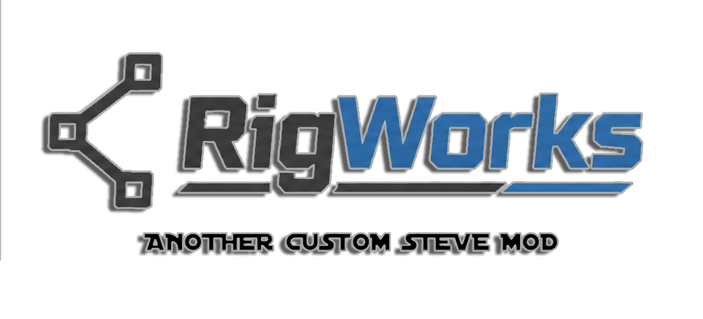
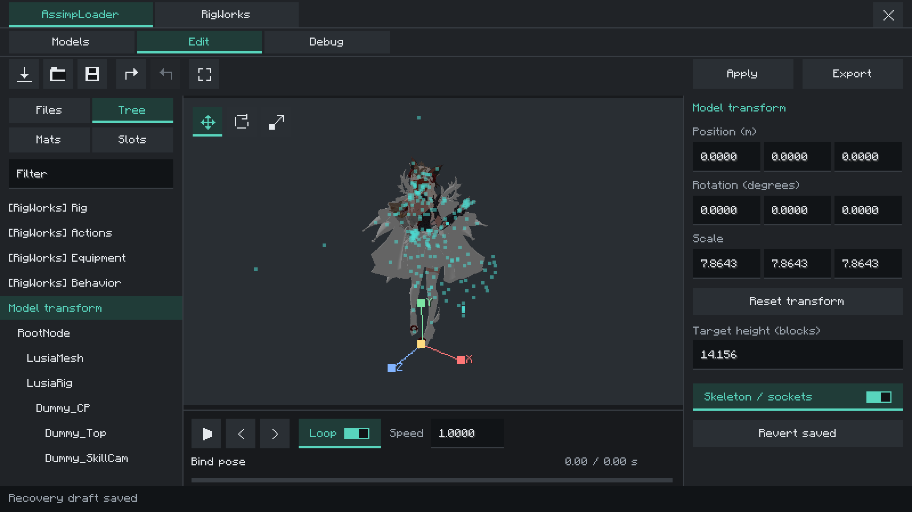
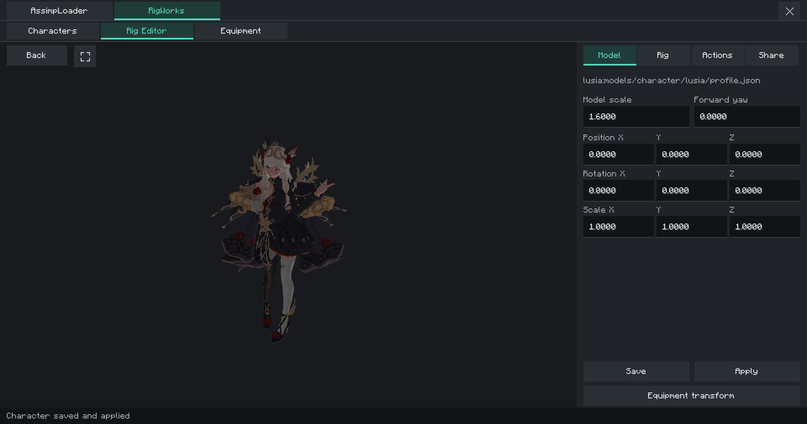
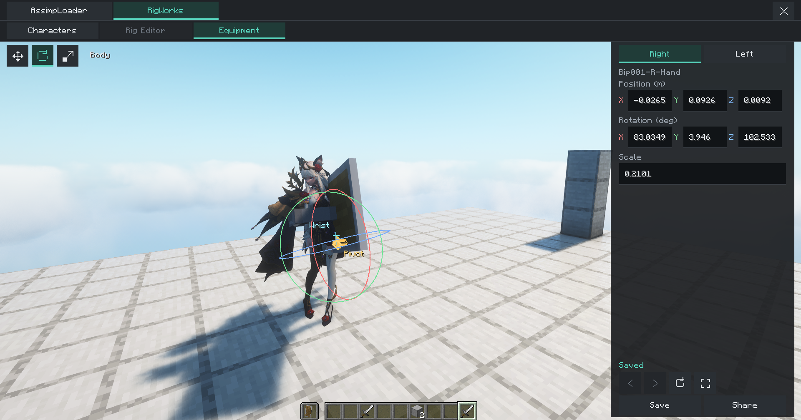
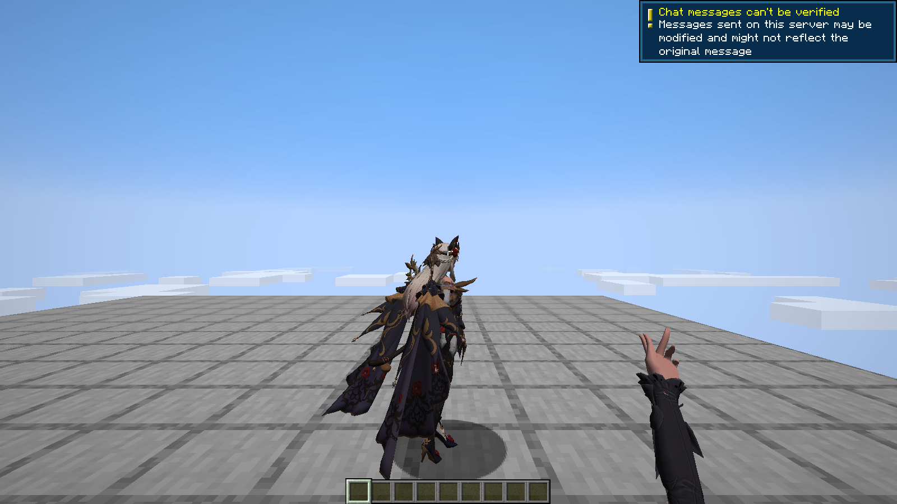

# RigWorks



<p align="center">
  <a href="README.en.md">English</a> · <a href="README.md">中文</a>
</p>

**A custom player model and animation system built on AssimpLoader.**

Available for Forge 1.20.1 and NeoForge 1.21.1. Import FBX / GLB files with custom skeletons, then tune proportions, body mapping, animation and held equipment in game — every player on the server sees the same character. Model loading, PBR and GPU skinning come from [AssimpLoader](https://github.com/MineRealms/AssimpLoader).



## Features

### Custom characters

- Custom skeletons of any layout, with body semantic mapping, proportion and orientation calibration, and full XYZ root transforms
- One independent configuration per character; source models and textures are never rewritten on import

### YSM import and runtime boundary

- Importing a `.ysm` file runs the RigWorks C++ converter once and writes a versioned, checksummed `.rwym` asset; later launches read the cache without decrypting the source again
- Legacy V3 layout 9 has real fixture coverage; V1/V2, Modern MXC and uncovered V3 payloads fail explicitly instead of producing a partial profile
- Local and remote players own their variables, controllers, blink, item snapshots and clocks while sharing immutable model/controller definitions; server collision and movement authority are unchanged
- The Workbench can validate, edit and package RWYM assets, but currently only registers the shared definition and does not drive a complete YSM controller instance in the preview window; controller preview remains tracked in the [YSM TODO](docs/development/YSM_PRIORITY_TODO.md)

### Vanilla actions

- Reads real player state and retargets walking, running, crouching, jumping, swimming, crawling, climbing, gliding, riding, sleeping and death
- Override any action with an imported clip or a script, or override only the upper body

### Blended animation and physics

- Layered combination of vanilla motion, imported clips, procedural poses and IK
- LookAt head tracking, foot placement, hand contacts
- Bullet rigid bodies and joints, Spring Bone, ragdoll
- Animation and physics update on the client tick; rendering consumes the result directly

### Equipment mounting

- Independent position / rotation / scale for each hand, with named sockets
- Rules matched by item, tag and state
- First-person arms and equipment layers, with held-item calibration against a frozen world frame

### In-game editing

- Import character models and character ZIPs through the native system file picker
- Unlocks Rig, Actions, Equipment and Behavior panels inside the shared AssimpLoader Edit screen
- Shared viewport and gizmo, free orbit, and a camera that is never pushed in by blocks

### Action scripting

- Optional KubeJS API
- Dedicated JSON / JS action packs under `kubejs/rigworks/avatars/<UUID>/`, isolated per player and never installed into global `client_scripts`

### Multiplayer consistency

- Server-side version negotiation, catalog notification, on-demand chunked download, SHA-256 verification and compressed caching
- Configuration caches are isolated per server
- The network only syncs appearance configuration and dedicated action packs — **no FBX, textures or audio**

### Saving and reloading

- Change detection and merged publication; the last valid version is kept when a reload fails
- Reopen saved projects with the original character action configuration intact

## Screenshots

| Workbench | Equipment | Sharing |
| --- | --- | --- |
|  |  |  |

## Getting started

Drop the two JARs for your Minecraft / loader combination into the client `mods/` folder:

- `rigworks-<mc>-<version>-<loader>.jar`
- `assimploader-<mc>-<version>-<loader>.jar`

Forge 1.20.1 uses Java 17 with Oculus / Embeddium; NeoForge 1.21.1 uses Java 21 with Iris / Sodium. KubeJS is optional.

Multiplayer sharing requires RigWorks and its dependencies on the server as well. Visual configuration never changes server hitboxes, movement rules or attack range.

In game, press `L` and use **RigWorks > Characters > Import avatar** to pick a character model or character ZIP, then edit the project tagged `[RigWorks]` inside **AssimpLoader > Edit**. `Apply` updates your local character, `Save` persists and applies, and `Export` packages the selected data into a re-importable ZIP.

## Documentation

| Topic | Docs |
| --- | --- |
| Models and skeletons | [Modeling workflow](docs/guides/CHARACTER_BLENDER_WORKFLOW.md) · [Custom rig calibration](docs/guides/CUSTOM_RIG_NATIVE_CALIBRATION.md) |
| Animation | [Beginner guide](docs/guides/ANIMATION_BEGINNER_GUIDE.md) · [Vanilla actions](docs/guides/PLAYER_VANILLA_ACTIONS.md) · [Native channels](docs/guides/RIGWORKS_NATIVE_CHANNELS.md) · [KubeJS](docs/guides/CHARACTER_KUBEJS_ACTIONS.md) |
| Equipment | [Equipment definition](docs/guides/CHARACTER_EQUIPMENT.md) · [3D transform workbench](docs/guides/EQUIPMENT_TRANSFORM_WORKBENCH.md) · [Hand contacts](docs/guides/RIGWORKS_HAND_CONTACTS.md) |
| Avatar packages | [Authoring sources and ZIP](docs/guides/AVATAR_AUTHORING_SOURCES.md) · [Copies and export options](docs/guides/RIGWORKS_AVATAR_PACKAGE.md) · [Behavior runtime](docs/guides/AVATAR_BEHAVIOR_RUNTIME.md) |
| Multiplayer | [Configuration sync](docs/guides/CHARACTER_CONFIGURATION_SYNC.md) · [Script reload lifecycle](docs/guides/KUBEJS_RELOAD_LIFECYCLE.md) |
| Development | [Development guide](docs/guides/DEVELOPMENT.md) · [YSM conversion pipeline](docs/development/YSM_RIGWORKS_PIPELINE.md) · [YSM TODO](docs/development/YSM_PRIORITY_TODO.md) · [Docs index](docs/README.md) |

## Building from source

```powershell
git clone --recurse-submodules https://github.com/MineRealms/RigWorks.git
cd RigWorks
.\gradlew.bat buildAndCollect --console=plain
.\gradlew.bat :1.21.1-neoforge:runClient -PwithKubeJS --console=plain
```

`AssimpLoader/` is a Git submodule pinned to a specific commit; Gradle builds the matching engine node first and produces an officially mapped development dependency. `build/distributions/` collects both RigWorks release JARs. RigWorks does not bundle the engine code and does not depend on AssimpShowcase.

If you already have a clone, run `git submodule update --init --recursive` first. A neighbouring engine checkout can be used with `-PassimpLoaderDir=../AssimpLoader`.

## License

[MIT](LICENSE).
