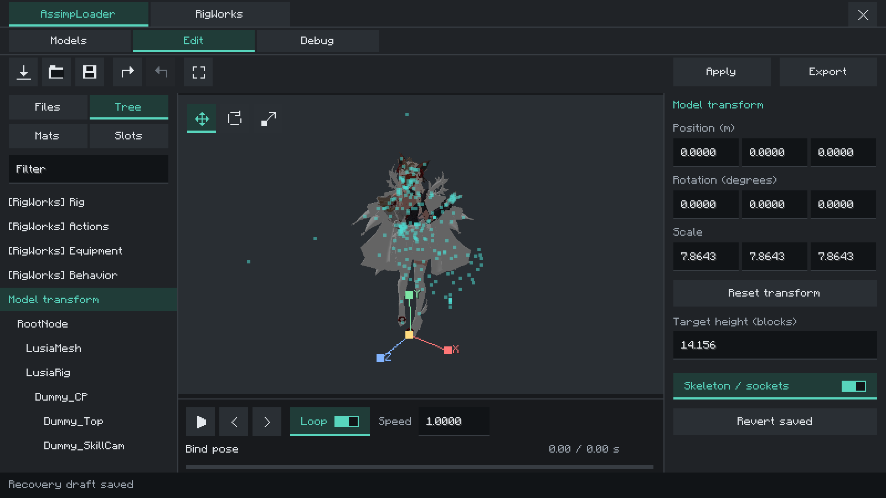

# RigWorks


**基于 AssimpLoader 的自定义玩家模型与动画系统，支持 Forge 1.20.1 和 NeoForge 1.21.1。**

导入自定义骨骼的 FBX / GLB，在游戏内调整角色比例、人体映射、动作与左右手装备，让同服玩家看到一致的外观配置。模型加载、PBR 和 GPU 蒙皮由 [AssimpLoader](https://github.com/MineRealms/AssimpLoader) 提供，RigWorks 是独立仓库和独立模组。



## 特色

| 领域 | 已实现内容 |
| --- | --- |
| 自定义角色 | 自定义骨架、人体语义映射、比例/朝向校准、完整 XYZ 根变换、独立角色配置 |
| 原版动作 | 观测真实玩家状态，重定向行走、奔跑、蹲伏、跳跃、游泳、滑翔及物品使用，支持片段和脚本覆盖 |
| 混合动画 | 原版动作、导入片段、程序化姿态与 IK 分层组合；接地、手部接触和视觉物理 |
| 装备挂载 | 左右手独立位置/旋转/缩放、命名挂点、物品/tag/状态规则、第一人称手臂和装备层 |
| 游戏内编辑 | RigWorks 显式导入角色，在 AssimpLoader 共享 Edit 中解锁 Rig、Actions、Equipment、Behavior；公共视口和 Gizmo，另有冻结世界姿态的双手装备校准 |
| 动作脚本 | 可选 `RigWorks` KubeJS API；`kubejs/rigworks/<avatar>/` 专用 JSON / JS 动作包，按玩家隔离运行 |
| 多人一致性 | 服务端接受版本、目录通知、按需分块下载、SHA-256 校验、压缩缓存和按服务器隔离的配置缓存 |
| 重载与保存 | 变化检查、合并发布、失败保留有效版本；重开已保存项目，保留原角色动作配置 |

动画与物理在客户端 tick 更新，渲染消费已完成姿态；主画面与阴影复用 GPU 数据。底层具备 VBO、GPU 蒙皮及 Oculus 缓存路径，具体收益取决于模型、材质、骨骼数量与光影设置。

## 开始使用

选择同一个 Minecraft / 加载器节点的两个 JAR，放入客户端 `mods/`：

- `rigworks-<mc>-<loader>-1.0.0.jar`
- `assimploader-<mc>-<loader>-1.0.0.jar`

Forge 1.20.1 使用 Java 17、Oculus / Embeddium；NeoForge 1.21.1 使用 Java 21、Iris / Sodium。KubeJS 分别使用 2001 / 2101 系列。迁移范围与实际验收结果见 [1.21.1 迁移记录](docs/development/1.21.1_MIGRATION.md)。

多人配置分享需要服务端也安装 RigWorks 及依赖。模型资产仍由玩家自行安装相同资源包或导入相同项目；网络只同步外观配置和专用动作包，**不传 FBX、贴图或声音**。

在游戏内按 `L`，通过 **RigWorks > Characters > Import avatar** 导入角色，或在公共导入窗口选择 **RigWorks**。随后在同一个 **AssimpLoader > Edit** 中编辑带 `[RigWorks]` 标记的项目：公共节点、材质、挂点、变换与角色专属面板共用一份会话。普通 **Model** 导入即使有骨骼，也不会启用角色或装备功能。

`Apply` 应用到本地角色，`Save` 持久化项目并应用，`Export` 输出可再次导入的完整 ZIP，包含模型、PBR 贴图、覆盖配置与专用 JSON/JS。编辑不改写 FBX。**[RigWorks] Equipment > Calibrate held items** 在冻结的世界画面校准左右手；相机自由环绕，不被方块推近。上传和显示他人的开关保留在 **Characters** 页。详见 [快速开始](docs/guides/QUICK_START.md)、[作者源码与 ZIP](docs/guides/AVATAR_AUTHORING_SOURCES.md)、[装备工作台](docs/guides/EQUIPMENT_TRANSFORM_WORKBENCH.md)和[配置同步](docs/guides/CHARACTER_CONFIGURATION_SYNC.md)。

上传配置与显示他人角色均有客户端开关。服务端不支持 RigWorks 时显示仅本地生效状态。视觉配置不会修改服务器碰撞箱、移动规则或攻击距离。

## 独立开发

第一次接触骨骼动画，先阅读 **[动画入门：原版动作、FBX、混合、IK 与 KubeJS](docs/guides/ANIMATION_BEGINNER_GUIDE.md)**，了解模型为什么能动，以及哪些内容需要在 3D 软件制作。

具体脚本操作见 **[KubeJS 玩家动画、骨骼、混合与 IK 教程](docs/guides/KUBEJS_ANIMATION_GUIDE.md)**，附 [Demo 安装与选择](examples/kubejs/README.md)。教程区分本地全局控制器和可向他人分发的专用动作包。

需要 Agent 从建模软件处理资产，可使用 AssimpLoader 的 **[自动化工作流](https://github.com/MineRealms/AssimpLoader/blob/multiversion/docs/guides/AGENT_ASSET_WORKFLOW.md)**、[Skill](https://github.com/MineRealms/AssimpLoader/blob/multiversion/skills/assimploader-asset-pipeline/SKILL.md) 及 [Blender / Maya / 3ds Max 导出工具](https://github.com/MineRealms/AssimpLoader/blob/multiversion/docs/guides/DCC_EXPORTERS.md)。本地工具在子模块 `AssimpLoader/tools/dcc/`；角色校准和保存继续使用 RigWorks 工作台。新增导出脚本尚未做运行验证。

```powershell
git clone --recurse-submodules https://github.com/MineRealms/RigWorks.git
cd RigWorks
.\gradlew.bat buildAndCollect --console=plain
.\gradlew.bat :1.21.1-neoforge:runClient -PwithKubeJS --console=plain
# 或旧版开发客户端：
.\gradlew.bat :1.20.1-forge:runClient -PwithKubeJS --console=plain
```

已有克隆先执行 `git submodule update --init --recursive`。`AssimpLoader/` 是固定提交的 Git 子模块；Gradle 先独立构建对应引擎节点，再生成官方映射的开发依赖，避免把 Forge 重混淆 JAR 直接用于开发。`build/distributions/` 收集两个 RigWorks 发布 JAR；引擎发布包在子模块自己的构建目录。RigWorks 不打包引擎代码，也不依赖 AssimpShowcase。

开发客户端默认包含对应版本光影栈，`-PwithoutOculus` 可关闭。`-PassimpLoaderDir=../AssimpLoader` 可用相邻引擎仓库开发。KubeJS 全局客户端脚本需显式安装示例；专用动作包独立于全局 `client_scripts` 环境。KubeJS 验收使用独立的 `run-kubejs-<mc>-<loader>/`，不会把生成的验收脚本留给普通客户端。

开发客户端默认窗口为 1600×900，可用 `-PclientWidth=1920 -PclientHeight=1080` 调整；GUI Scale 在游戏视频设置中修改。本轮统一编辑、ZIP 往返和双客户端配置更新的实际记录见 [2026-11-19 验收](docs/development/UNIFIED_WORKBENCH_VALIDATION_2026-11-19.md)。

| 主题 | 文档 |
| --- | --- |
| 模型与骨架 | [建模工作流](docs/guides/CHARACTER_BLENDER_WORKFLOW.md) · [原版动作校准](docs/guides/CUSTOM_RIG_NATIVE_CALIBRATION.md) |
| 动作 | [原版动作](docs/guides/PLAYER_VANILLA_ACTIONS.md) · [原生通道](docs/guides/RIGWORKS_NATIVE_CHANNELS.md) · [KubeJS](docs/guides/CHARACTER_KUBEJS_ACTIONS.md) |
| 装备 | [装备定义](docs/guides/CHARACTER_EQUIPMENT.md) · [3D 变换工作台](docs/guides/EQUIPMENT_TRANSFORM_WORKBENCH.md) · [手部接触](docs/guides/RIGWORKS_HAND_CONTACTS.md) |
| GUI 扩展 | [引擎的分区与页面注册接口](https://github.com/MineRealms/AssimpLoader/blob/multiversion/docs/guides/WORKSPACE_EXTENSIONS.md) · [双分区与相机验收](docs/development/WORKSPACE_GUI_2026-11-19.md) |
| 多人和脚本包 | [配置分发](docs/guides/CHARACTER_CONFIGURATION_SYNC.md) · [专用动作包](docs/guides/AVATAR_BEHAVIOR_RUNTIME.md) |
| 开发与历史 | [开发指南](docs/guides/DEVELOPMENT.md) · [文档索引](docs/README.md) · [历史提取说明](docs/history/REPOSITORY_EXTRACTION.md) |

## 许可

[MIT](LICENSE)。原仓库相关历史经过路径提取保留，作者、作者时间和提交时间未重新编造；AssimpLoader 原仓库历史未改写。
