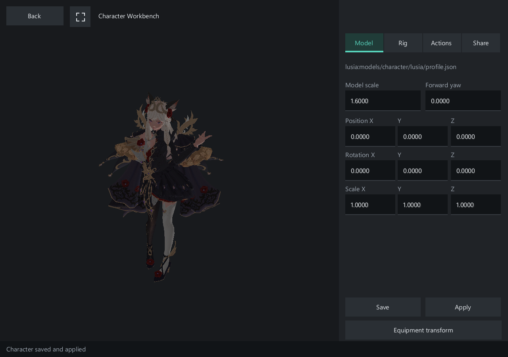

# RigWorks

**基于 AssimpLoader 的 Minecraft Forge 1.20.1 自定义玩家模型与动画系统。**

导入自定义骨骼的 FBX / GLB，在游戏内调整角色比例、人体映射、动作与左右手装备，让同服玩家看到一致的外观配置。模型加载、PBR 和 GPU 蒙皮由 [AssimpLoader](https://github.com/MineRealms/AssimpLoader) 提供，RigWorks 是独立仓库和独立模组。



## 特色

| 领域 | 已实现内容 |
| --- | --- |
| 自定义角色 | 自定义骨架、人体语义映射、比例/朝向校准、完整 XYZ 根变换、独立角色配置 |
| 原版动作 | 观测真实玩家状态，重定向行走、奔跑、蹲伏、跳跃、游泳、滑翔及物品使用，支持片段和脚本覆盖 |
| 混合动画 | 原版动作、导入片段、程序化姿态与 IK 分层组合；接地、手部接触和视觉物理 |
| 装备挂载 | 左右手独立位置/旋转/缩放、命名挂点、物品/tag/状态规则、第一人称手臂和装备层 |
| 游戏内编辑 | 扩展模型工作台，实时预览角色与片段；冻结姿态、绑定点、描边与 3D Gizmo 辅助装备校准 |
| 动作脚本 | 可选 `RigWorks` KubeJS API；`kubejs/rigworks/<avatar>/` 专用 JSON / JS 动作包，按玩家隔离运行 |
| 多人一致性 | 服务端接受版本、目录通知、按需分块下载、SHA-256 校验、压缩缓存和按服务器隔离的配置缓存 |
| 重载与保存 | 变化检查、合并发布、失败保留有效版本；重开已保存项目，保留原角色动作配置 |

动画与物理在客户端 tick 更新，渲染消费已完成姿态；主画面与阴影复用 GPU 数据。底层具备 VBO、GPU 蒙皮及 Oculus 缓存路径，具体收益取决于模型、材质、骨骼数量与光影设置。

## 开始使用

需要 **Minecraft 1.20.1、Forge 47.x、Java 17**。将以下两个文件放入客户端 `mods/`：

- `rigworks-1.0.0.jar`
- `assimploader-1.0.0-all.jar`

多人配置分享需要服务端也安装 RigWorks 及依赖。模型资产仍由玩家自行安装相同资源包或导入相同项目；网络只同步外观配置和专用动作包，**不传 FBX、贴图或声音**。

在游戏内按 `L` 打开工作区，进入 `Edit` 导入模型，再打开 `Character / RigWorks` 校准和应用。`Apply` 更新当前角色，`Save` 保存后可重新打开；已有角色的动作、脚本及装备配置会继承。详见 [快速开始](docs/guides/QUICK_START.md)和[配置同步](docs/guides/CHARACTER_CONFIGURATION_SYNC.md)。

上传配置与显示他人角色均有客户端开关。服务端不支持 RigWorks 时显示仅本地生效状态。视觉配置不会修改服务器碰撞箱、移动规则或攻击距离。

## 独立开发

具体脚本操作见 **[KubeJS 玩家动画、骨骼、混合与 IK 教程](docs/guides/KUBEJS_ANIMATION_GUIDE.md)**，附 [Demo 安装与选择](examples/kubejs/README.md)。教程区分本地全局控制器和可向他人分发的专用动作包。

```powershell
git clone --recurse-submodules https://github.com/MineRealms/RigWorks.git
cd RigWorks
.\gradlew.bat build --console=plain
.\gradlew.bat :assimploader:build --console=plain
.\gradlew.bat runClient -PwithKubeJS --console=plain
```

已有克隆先执行 `git submodule update --init --recursive`。`AssimpLoader/` 是固定提交的 Git 子模块，Gradle 使用其源码保证开发映射一致。两个项目各自产出独立 JAR；RigWorks 不打包引擎代码，也不依赖 AssimpShowcase。

开发客户端默认包含 Oculus / Embeddium，`-PwithoutOculus` 可关闭。KubeJS 全局客户端脚本需显式安装示例；专用动作包独立于全局 `client_scripts` 环境。

| 主题 | 文档 |
| --- | --- |
| 模型与骨架 | [建模工作流](docs/guides/CHARACTER_BLENDER_WORKFLOW.md) · [原版动作校准](docs/guides/CUSTOM_RIG_NATIVE_CALIBRATION.md) |
| 动作 | [原版动作](docs/guides/PLAYER_VANILLA_ACTIONS.md) · [原生通道](docs/guides/RIGWORKS_NATIVE_CHANNELS.md) · [KubeJS](docs/guides/CHARACTER_KUBEJS_ACTIONS.md) |
| 装备 | [装备定义](docs/guides/CHARACTER_EQUIPMENT.md) · [3D 变换工作台](docs/guides/EQUIPMENT_TRANSFORM_WORKBENCH.md) · [手部接触](docs/guides/RIGWORKS_HAND_CONTACTS.md) |
| 多人和脚本包 | [配置分发](docs/guides/CHARACTER_CONFIGURATION_SYNC.md) · [专用动作包](docs/guides/AVATAR_BEHAVIOR_RUNTIME.md) |
| 开发与历史 | [开发指南](docs/guides/DEVELOPMENT.md) · [文档索引](docs/README.md) · [历史提取说明](docs/history/REPOSITORY_EXTRACTION.md) |

## 许可

[MIT](LICENSE)。原仓库相关历史经过路径提取保留，作者、作者时间和提交时间未重新编造；AssimpLoader 原仓库历史未改写。
