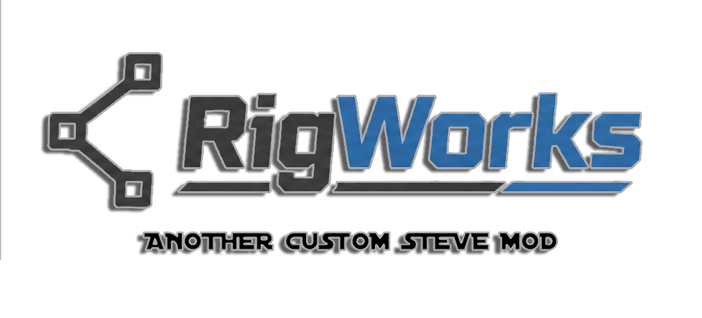
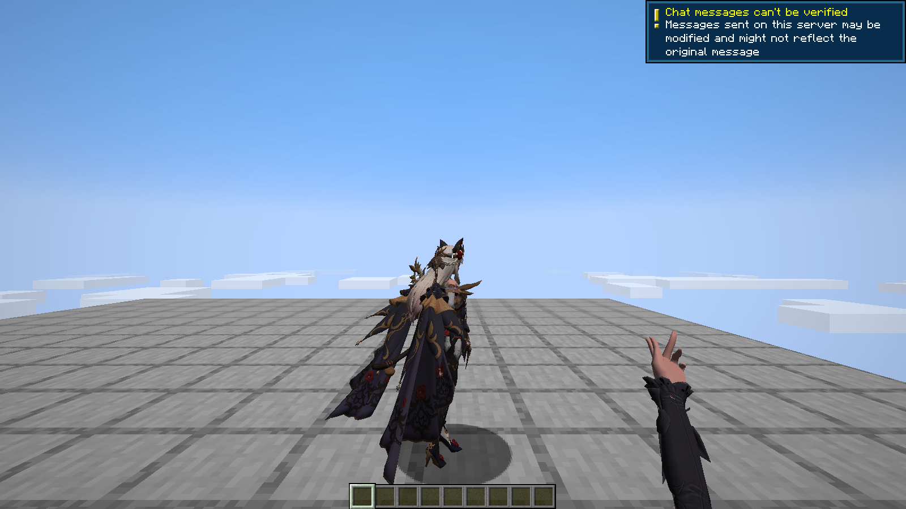

# RigWorks



<p align="center">
  <a href="README.en.md">English</a> · <a href="README.md">中文</a>
</p>

**基于 AssimpLoader 的自定义玩家模型与动画系统。**

支持 Forge 1.20.1 与 NeoForge 1.21.1。导入带自定义骨架的 FBX / GLB，在游戏内调整比例、人体映射、动作和左右手装备，同服玩家看到一致的外观。模型加载、PBR 与 GPU 蒙皮由 [AssimpLoader](https://github.com/MineRealms/AssimpLoader) 提供。


## 特性

### 自定义角色

- 任意自定义骨架，人体语义映射、比例与朝向校准、完整 XYZ 根变换
- 每个角色独立配置，导入时不改写原始模型与贴图

### YSM 支持

- 支持 Legacy V3 `.ysm` 导入：由 RigWorks 的 C++ 转换器一次生成带版本和校验的 `.rwym` 缓存，后续启动直接读取缓存。
- 支持模型骨骼、刚性蒙皮、贴图、动画片段、controller、Molang 表达式子集、眨眼查询和 YSM locator；模型朝向与装备挂点沿用模型提供的数据。
- 本地和远程角色拥有独立的 controller、变量、动画时间、物品状态和眨眼状态，同时共享只读模型定义；服务端碰撞、移动和伤害仍由 Minecraft 权威处理。
- 支持主副手状态、模型提供的持物和使用动作，以及可选的 TaCZ 动作输入适配；具体效果取决于模型提供的动画和控制器。
- 不支持 Legacy V1/V2 外层容器和 Modern MXC；模型自定义函数、完整历史动作分类、音效事件、变体武器和 Workbench 内的完整 YSM controller 预览仍在扩展中。

### 原版动作

- 读取真实玩家状态，重定向行走、奔跑、蹲伏、跳跃、游泳、爬行、攀爬、滑翔、骑乘、睡眠与死亡
- 可用导入片段或脚本覆盖任意动作，也能只覆盖上半身
- `DEFAULT` 内置 25 段已求解的 VMD 来源动作，纯 Java 按人体映射重定向到 FBX 骨架，无需模型自带这些片段；YSM 保持自己的动作系统

### 混合动画与物理

- 原版动作、导入片段、程序化姿态与 IK 分层组合
- LookAt 头部追踪、脚部贴地、手部接触
- Bullet 刚体与关节、Spring Bone、布娃娃
- 动画与物理在客户端 tick 更新，渲染直接消费结果

### 装备挂载

- 左右手独立的位置 / 旋转 / 缩放，命名挂点
- 按物品、tag 与状态匹配的规则
- 第一人称手臂与装备层，冻结世界画面下校准持物姿态

### 游戏内编辑

- 角色模型与角色 ZIP 通过系统原生文件选择框导入
- 在 AssimpLoader 共享 Edit 中解锁 Rig、Actions、Equipment、Behavior 面板
- 公共视口与 Gizmo，自由环绕，相机不被方块推近

### 动作脚本

- 可选 KubeJS API
- `kubejs/rigworks/avatars/<UUID>/` 下的专用 JSON / JS 动作包，按玩家隔离运行，不安装到全局 `client_scripts`

### 多人一致性

- 服务端版本协商、目录通知、按需分块下载、SHA-256 校验、压缩缓存
- 配置缓存按服务器隔离
- 网络只同步外观配置与专用动作包，**不传 FBX、贴图或声音**

### 保存与重载

- 变化检查、合并发布，失败时保留上一个有效版本
- 重新打开已保存项目，原角色动作配置继续可用

## 截图

| 统一工作台 | 装备校准 | 角色分享 |
| --- | --- | --- |
|  |  |  |

## 开始使用

把同一个 Minecraft / 加载器节点的两个 JAR 放进客户端 `mods/`：

- `rigworks-<mc>-<version>-<loader>.jar`
- `assimploader-<mc>-<version>-<loader>.jar`

Forge 1.20.1 使用 Java 17 与 Oculus / Embeddium，NeoForge 1.21.1 使用 Java 21 与 Iris / Sodium。KubeJS 可选。

多人配置分享需要服务端也安装 RigWorks 及依赖。视觉配置不会修改服务器碰撞箱、移动规则或攻击距离。

在游戏内按 `L`，通过 **RigWorks > Characters > Import avatar** 选择角色模型或角色 ZIP，然后在 **AssimpLoader > Edit** 中编辑带 `[RigWorks]` 标记的项目。`Apply` 应用到本地角色，`Save` 保存并应用，`Export` 选择要打包的数据后输出可再次导入的 ZIP。

## 文档

| 主题 | 文档 |
| --- | --- |
| 模型与骨架 | [建模工作流](docs/guides/CHARACTER_BLENDER_WORKFLOW.md) · [自定义骨架校准](docs/guides/CUSTOM_RIG_NATIVE_CALIBRATION.md) |
| 建模样例 | [御坂妹妹：方块造型、DEFAULT 与裙发物理](docs/guides/MISAKA_PIXEL_AVATAR.md) |
| 动作 | [动画入门](docs/guides/ANIMATION_BEGINNER_GUIDE.md) · [DEFAULT 预设](docs/guides/DEFAULT_MOTION_PRESET.md) · [原版动作](docs/guides/PLAYER_VANILLA_ACTIONS.md) · [原生通道](docs/guides/RIGWORKS_NATIVE_CHANNELS.md) · [KubeJS](docs/guides/CHARACTER_KUBEJS_ACTIONS.md) |
| 装备 | [装备定义](docs/guides/CHARACTER_EQUIPMENT.md) · [3D 变换工作台](docs/guides/EQUIPMENT_TRANSFORM_WORKBENCH.md) · [手部接触](docs/guides/RIGWORKS_HAND_CONTACTS.md) |
| 角色包 | [作者源码与 ZIP](docs/guides/AVATAR_AUTHORING_SOURCES.md) · [角色副本与导出选项](docs/guides/RIGWORKS_AVATAR_PACKAGE.md) · [动作包运行时](docs/guides/AVATAR_BEHAVIOR_RUNTIME.md) |
| 多人 | [配置同步](docs/guides/CHARACTER_CONFIGURATION_SYNC.md) · [脚本重载生命周期](docs/guides/KUBEJS_RELOAD_LIFECYCLE.md) |
| 开发 | [开发指南](docs/guides/DEVELOPMENT.md) · [YSM 转换管线](docs/development/YSM_RIGWORKS_PIPELINE.md) · [YSM TODO](docs/development/YSM_PRIORITY_TODO.md) · [文档索引](docs/README.md) |

## 从源码构建

```powershell
git clone --recurse-submodules https://github.com/MineRealms/RigWorks.git
cd RigWorks
.\gradlew.bat buildAndCollect --console=plain
.\gradlew.bat :1.21.1-neoforge:runClient -PwithKubeJS --console=plain
```

`AssimpLoader/` 是固定提交的 Git 子模块，Gradle 会先独立构建对应引擎节点，再生成官方映射的开发依赖。`build/distributions/` 收集两个 RigWorks 发布 JAR。默认发布包不包含引擎；RigWorks 不依赖 AssimpShowcase。

要同时生成独立版和内置 AssimpLoader 的 Jar-in-Jar 版，执行：

```powershell
.\gradlew.bat buildAndCollectBundled --no-daemon --console=plain
```

输出目录是 `build/distributions/`。普通文件名以 `rigworks-...-forge.jar` 或 `rigworks-...-neoforge.jar` 结尾；内置版追加 `-with-assimploader.jar`。内置版将完整 AssimpLoader 发行 JAR 放在 `META-INF/jarjar/`，因此安装时只需要这一个 RigWorks 文件；普通版仍需要单独安装匹配版本的 AssimpLoader。

该任务会自动构建匹配节点的 AssimpLoader 发行包，并检查 Mixin 注册、refmap、嵌套依赖和原生库。发行目录同时包含从内置版提取的两份独立 AssimpLoader JAR，确保字节一致。也可用 `-PassimpLoaderBundleJar=<发行 JAR 路径>` 指定已有引擎包。更新 JAR 后需要重启客户端。

已有克隆先执行 `git submodule update --init --recursive`。相邻引擎仓库可用 `-PassimpLoaderDir=../AssimpLoader` 指定。

## 许可

[MIT](LICENSE)。
