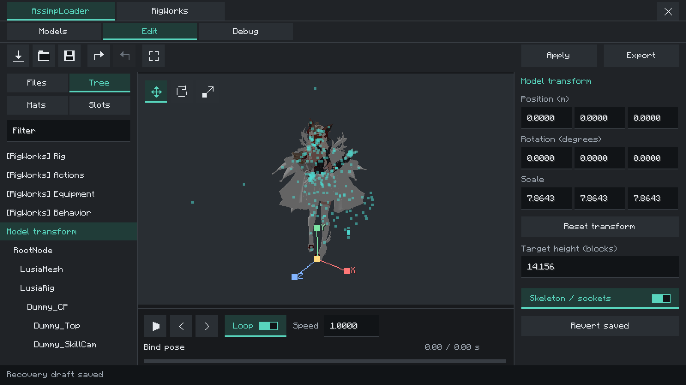
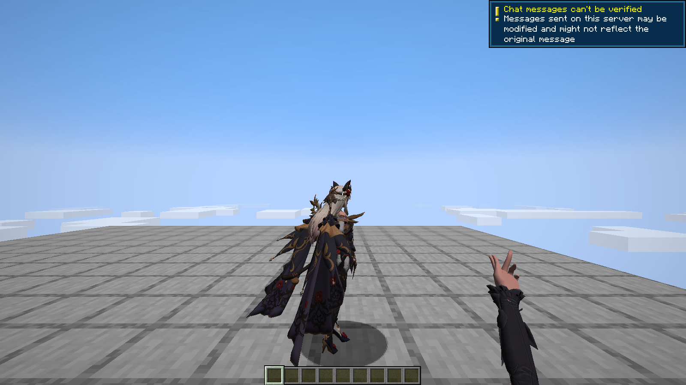

# 统一工作台与双客户端验收

日期：2026-11-19。该记录区分自动构建、实际客户端与尚未运行的环境，取代当天较早独立 Rig Editor 界面的入口说明。

## 当前工作流程

AssimpLoader 的普通 Model 导入只创建通用项目。RigWorks 的 Import avatar 入口显式预处理角色，随后在同一个 AssimpLoader Edit 中显示 `[RigWorks]` 的 Rig、Actions、Equipment、Behavior 面板。模型、节点、材质、挂点、Gizmo 和项目保存由引擎提供；角色应用、骨骼动作、装备、作者源和服务器分发由 RigWorks 提供。

Save 持久化项目并应用本地角色；Apply 更新本地角色；Export 生成可重新导入的 ZIP。FBX 原文件不被重写，节点/材质/挂点以覆盖配置参与运行时渲染。没有游戏对象引用普通模型时，Apply 不会生成展示实体。

## 统一编辑与 ZIP 往返

环境：NeoForge 1.21.1，KubeJS/Rhino 2101，Iris/Sodium，ComplementaryRocket_Local；1600×900，GUI Scale 2。使用真实 Lusia FBX 和 PBR 贴图。

最终代码于 19:17:41 完成该轮验收；结果为 `passed: true`、`stage: 13`。完整客户端同时验证不同 Cull/Blend 策略使用独立且可复用的 RenderType，结果字段为 `materialRenderTypePolicies: true`。

- 同一个带骨骼资产通过普通入口导入，没有 RigWorks 标记；显式角色入口继承现有人体、装备、动作及原 KubeJS 控制器。
- 切换 AssimpLoader/RigWorks 分区后保留同一项目；公共根变换正确保留原始比例及前向校准。
- Save/Apply 后重新打开保留变换与材质覆盖；外部角色 JSON 修改后 Reload、外部项目 JSON 修改后重开均读取新值，磁盘文档和已保存编辑器状态一致。
- 原脚本在合成 walk/run/idle 输入下仍切换动作，不因编辑丢失控制器。这是游戏实际类的输入探针，不等于所有键盘动作已逐项操作。
- 实际点击 Export，再从生成的 ZIP 导入新项目，恢复标记、变换、材质覆盖与 3 个专用作者文件；预览 5 组 PBR 纹理就绪。
- 测试结束恢复原本地角色配置，避免反复测试叠加比例。

机器结果：[unified-workbench-neoforge-2026-11-19.json](../validation/unified-workbench-neoforge-2026-11-19.json)。原始路径在结果中保留，用于追查当时生成的项目和 ZIP。

## 真实双客户端

环境：两个独立 NeoForge 1.21.1 客户端及一次性集成 LAN 世界；使用不同离线开发 UUID。两边预装相同 FBX/贴图，接收端没有作者动作包。该轮未启用 ShaderPack，用于验证分发、实例和脚本生命周期。

| 检查 | 实际结果 |
| --- | --- |
| 首次发布 | 服务器接受第一版，接收端后台下载并建立远端模型，真实脚本开始执行 |
| 关闭他人显示 | 远端模型取消显示，脚本调用次数停止，压缩磁盘缓存保留 |
| 重新开启 | 从有效缓存恢复对应角色，脚本重新运行 |
| 第二版 Apply | 左右手装备和根旋转改变，服务器接受更高配置版本及不同包哈希 |
| 新脚本发布 | 接收端实际运行第二版源码哈希，旧脚本不会提前替换 |
| 缓存 | 解码并校验 `.bin` 包身份；接收缓存没有明文 `.js`，没有写入作者目录 |
| 最终绘制 | 1 个有效远端 binding，实际绘制 116 次，未报告绑定或脚本失败 |

首轮发现关闭他人显示后异步绑定可能重新出现。修复 NeoForge 当前配置对象引用，并在远端加载发起、完成和取姿态时检查策略。修复后的完整流程通过，未将失败运行计为成功。

机器结果：[发送端](../validation/character-sharing-owner-neoforge-2026-11-19.json)、[接收端](../validation/character-sharing-viewer-neoforge-2026-11-19.json)。这两个验收客户端已在最终构建前关闭；最终统一工作台验收所用的光影客户端保留运行。图片显示两个玩家使用同一基础资产，不意味着共用可变动作或变换实例。

## 构建与边界

RigWorks `buildAndCollect -PassimpLoaderDir=../AssimpLoader --offline` 通过 Forge 1.20.1、NeoForge 1.21.1 的编译、测试、集成验收源码编译、发布与模块隔离检查；测试分别为 180、185 项，无失败、错误或跳过。AssimpLoader 两节点各 470 项测试，无失败/错误，各 2 项按需 GPU 测试未启用；构建包含 Showcase 与发布内容隔离检查。

渲染收尾接通共享 Mesh 的节点实例显隐、双面、MASK cutoff 和强制 OPAQUE。Alpha 在后台基础色变体处理，保留源图与 PBR 通道；SOURCE 是新导入默认，不把原有透明裁切强制变成不透明。相关测试覆盖相同网格/名字/变换、父节点隐藏、子集和乱序提交、owner 恢复、纯显隐不移动节点，以及 Alpha 阈值边界、无图材质和原图/PBR 保持。RenderType 的状态缓存检查放在完整客户端验收入口，避免普通单测伪造 NeoForge 引导环境。

两个模组在两个节点的发布 JAR 均核对了 `icon.png` SHA-256 与用户提供 PNG 完全相同，并包含 `logoFile="icon.png"` 元数据。

本轮仍未验证：独立专服、正常认证登录、跨维度、断线重连、抖动网络、多玩家压力及 Forge 新 GUI 的整套真实交互。共享源码和测试不代替这些现场验证。旧全局任意 KubeJS 也不能自动转换成受限、可分发的 avatar 包；原本地控制器保留，可分发行为使用 `kubejs/rigworks/<avatar>/`。压缩缓存不是加密或零拷贝。

后续清单见 [UNIFIED_WORKBENCH_TODO.md](UNIFIED_WORKBENCH_TODO.md)。
