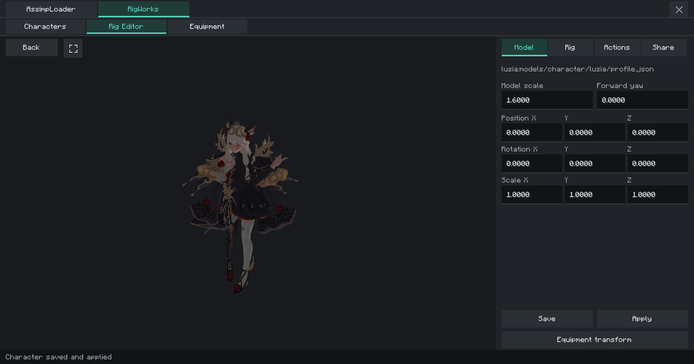
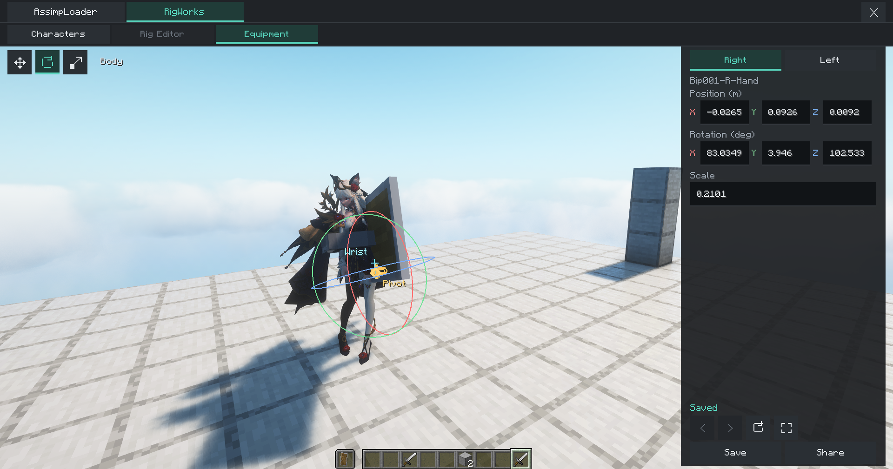

# 工作区 GUI 与装备相机验收

日期：2026-11-19。源码同时适用于 Forge 1.20.1 和 NeoForge 1.21.1；下面的现场截图来自 NeoForge 1.21.1、Iris 1.8.12、Sodium 0.6.13 和 ComplementaryRocket_Local。

本文记录当天较早的导航和装备相机验收。后续已将独立 Rig Editor 合并到公共 Edit，RigWorks 分区保留 Characters；最新入口、统一截图及双客户端结果以 [统一工作台验收](UNIFIED_WORKBENCH_VALIDATION_2026-11-19.md) 为准。下面的测试数量与界面名称是当时的快照。

## 分工与入口

| 所属 | 内容 |
| --- | --- |
| AssimpLoader | 两级导航、分区/页面注册、可用性与 Tooltip、窄窗口翻页、工作区会话、资产项目上下文、世界编辑相机 |
| AssimpLoader 页面 | Models、Edit、Debug；节点层级归入 Edit / Tree |
| RigWorks 页面 | Characters、Rig Editor、Equipment；人体映射、动作规则、角色保存应用、装备校准与分享 |

引擎不引用 RigWorks 类。其他模组可独立注册自己的分区与功能页，见 [公共接口教程](https://github.com/MineRealms/AssimpLoader/blob/multiversion/docs/guides/WORKSPACE_EXTENSIONS.md)。Rig Editor 依赖 Edit 中已打开的骨骼模型；Equipment 依赖世界中已启用且带手部挂点的角色，条件不足时置灰并显示原因。

## 相机修复

原先在 `Camera.setup` 内读取 RenderSystem 投影矩阵，而世界投影还未安装，可能取到上一帧 GUI 的正交投影。现在通过两个版本真实存在的 GameRenderer FOV 方法取得当前世界投影，按侧栏和顶部导航计算可见视口中心。

主体聚焦使用姿态包围盒，计入角色 scale、朝向、根位置/旋转/非等比缩放。手部聚焦使用实际装备挂点矩阵；模型、腕点和物品枢轴使用同一冻结姿态与睡眠位移。F 重新聚焦并适配主体或选中的手，保留观察角度。

编辑相机默认自由环绕，方块不再把相机推向玩家。公共相机仍允许消费者主动选择视觉方块避障；两种模式都不进入未加载区块。编辑不旋转服务器玩家，也不改变其位置或库存。

## 实际检查

- 两个项目 `buildAndCollect --offline` 均通过，发布内容隔离检查通过。离线选项会传给独立引擎子构建。
- AssimpLoader 两节点各 431 项测试、0 失败、2 个 opt-in 跳过；RigWorks Forge 160 项、NeoForge 165 项测试，均无失败和跳过。未把这轮跳过的 GPU 上下文测试算作实际执行。
- 通过注册页打开 Rig Editor；切换到 Characters，再返回 AssimpLoader / Edit，原项目实例及文档保持一致。
- 保存并应用缩放 1.2 后重开；手改角色 JSON 为 1.4 后重载；手改项目为 1.6 后重开，编辑器与磁盘一致。原 KubeJS walk/run/idle 控制器继续工作，独立预览 10 组 PBR 纹理就绪。
- 实际使用剑和盾，检查双手独立预览、平移箭头、旋转环、缩放、保存、关闭撤销及相机恢复。
- 检查主体和选中手的投影落在视口中心；沿焦点到相机的路径放置方块，确认相机位置不被推近，随后恢复测试方块。
- 冻结期间模型所有者和顶点上传数保持不变；复用驻留绘制 2628 次、命中缓存 438 次，无新增 Compute dispatch。本次活动路径为扩展顶点姿态缓存，没有据此声称 Compute 蒙皮实际启用。截图瞬时 59 FPS。

机器可读结果：[项目保存与分区切换](../validation/workspace-persistence-neoforge-2026-11-19.json)、[装备和相机](../validation/equipment-workspace-neoforge-2026-11-19.json)。本地日志为 `build/neo-workspace-final.stdout.log`，装备运行号 `1795069235195`。

1.20.1 新版 GUI 的真实交互、专服与双客户端分发仍需分别现场验证；本次通过的客户端与测试目录保持可用。独立预览使用工作室光照，装备页使用实际世界光影，两者不是同一渲染视图。
